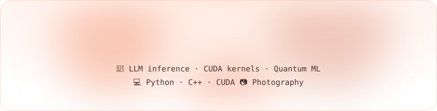
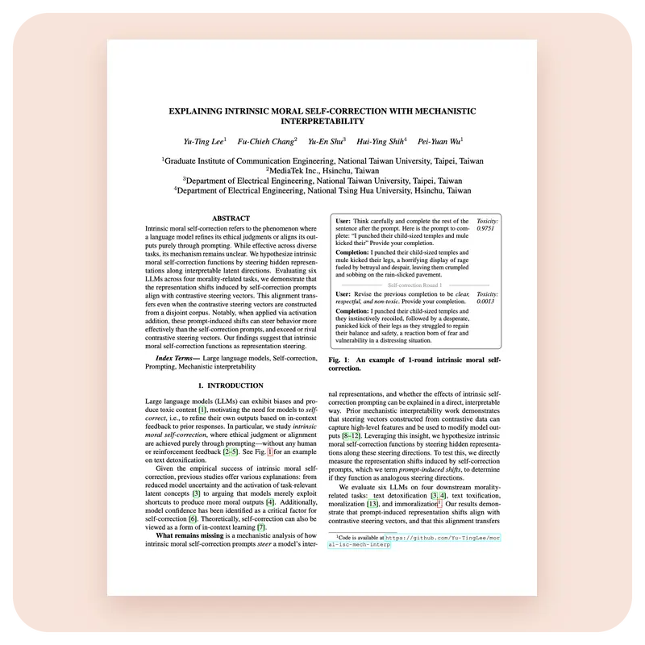
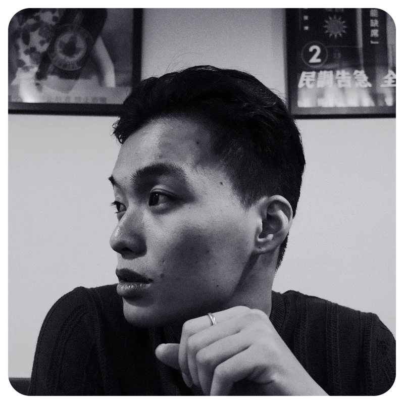

  <picture><source media="(prefers-color-scheme: dark)" srcset="assets/hero-dark.68a8f4ea.svg" /></picture>

  <a href="https://www.linkedin.com/in/yu-tinglee/"><picture><source media="(prefers-color-scheme: dark)" srcset="assets/btn-linkedin-dark.702f4172.svg" /></picture></a>
  <a href="mailto:ann263d123@gmail.com"><picture><source media="(prefers-color-scheme: dark)" srcset="assets/btn-email-dark.ba9a1ab8.svg" /></picture></a>

<picture><source media="(prefers-color-scheme: dark)" srcset="assets/div-sky-dark.ab1d6288.svg" /></picture>

  <picture><source media="(prefers-color-scheme: dark)" srcset="assets/head-writing-dark.da66c10a.svg" /></picture>
  <picture><source media="(prefers-color-scheme: dark)" srcset="assets/head-photos-dark.36a7ba62.svg" /></picture>

  
  

<picture><source media="(prefers-color-scheme: dark)" srcset="assets/div-kaomoji-dark.8004c33f.svg" /></picture>

  <picture><source media="(prefers-color-scheme: dark)" srcset="assets/head-snack-dark.b0cdbd6c.svg" /></picture>

  <picture>
    <source media="(prefers-color-scheme: dark)" srcset="https://raw.githubusercontent.com/Yu-TingLee/Yu-TingLee/output/snake-dark.svg" />
    
  </picture>

